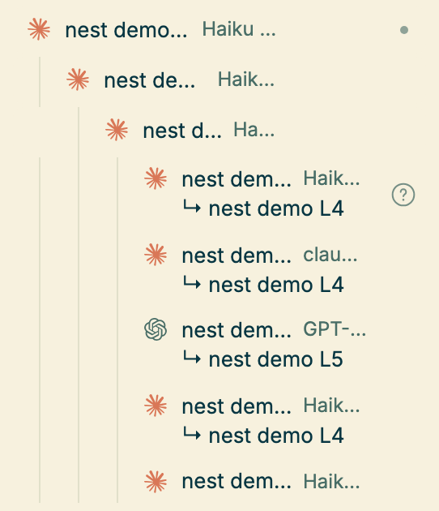

# nest

A [bb](https://getbb.app) plugin that lets an agent at any depth start worker
threads. bb accepts a child thread only four levels deep, so `bb thread spawn
--parent-self` fails from a fourth-level thread with `too_deep`. `bb nest
spawn` works from every level.

```sh
read -r -d '' brief <<'BRIEF'
<the complete brief>
BRIEF
bb nest spawn --new-environment worktree --provider claude-code \
  --model claude-sonnet-5-5 --title "Fix the flaky test" --prompt "$brief"
```

The calling thread (`BB_THREAD_ID`) is always the parent. `bb nest spawn
--help` lists every option. They match `bb thread spawn`: `--project`,
`--environment`, `--new-environment`, `--base-branch`, `--provider`,
`--model`, `--reasoning-level`, `--title`, `--prompt`, `--prompt-file`,
`--parent-notifications`, and `--json`. `--parent-self` is accepted and
changes nothing.

`--parent-notifications` chooses which of the worker's turn outcomes wake the
caller: `auto` (every outcome, the default), `stuck` (failures and waits on an
approval or question), or `off`. It applies to relay workers too. Use `off`
when the caller waits with `bb thread wait` and a new turn would interrupt
work that runs after the caller's turn ends.

`--tag <tag>`, repeatable, gives the new thread a tag of the
[mail](../mail/README.md) plugin, such as `--tag role=reviewer`. Mail selects
recipients by tag. The worker's own workers do not inherit it.

## Install

From this repository:

```sh
cd bb-plugins/nest
npm install
bb plugin install . --yes
```

## How it works

When bb lets the caller take a child, `bb nest spawn` starts a normal child,
exactly as `bb thread spawn --parent-self` would. bb then notifies the caller
when the child finishes.

Otherwise the plugin starts the worker under the nearest ancestor that can
take a child. That ancestor is only a host:

- The worker's parent notifications are off, so the host hears nothing.
- The caller owns the worker's lifecycle, so archiving the caller archives
  the worker and everything the worker started.
- The worker's first message starts with a short note. It names the caller as
  its logical parent and tells the worker not to message the host.
- When the worker ends a turn, fails, or waits on an approval or question, the
  plugin sends the caller a message from the worker, unless the spawn's
  `--parent-notifications` leaves that outcome out. The message wakes the
  caller and says it needs no reply. It holds a final reply of up to 4,000
  characters. A longer reply arrives as one line with its first line, its
  length, and the `bb thread output` command that reads it.
- A turn that ended only to start self-compaction is not relayed, because the
  worker resumes on its own. That is the helper (`bb-compact.mjs run` without
  `--no-resume`, exiting 0) for Claude Code, or a Hermes `self_compact` call that
  scheduled a compaction without `resume: false`. bb's compaction turn after it is not relayed
  either.
- A turn whose whole reply is `[no-op]` (after trimming) is not relayed. A reply that
  only contains the marker is relayed.

`bb nest list --parent <thread>` lists a thread's unarchived workers from
both routes. The `route` column shows `child` or `relay`.

## Sidebar badge

A relay worker appears in the sidebar under its host. The plugin adds a
`↳ <caller title>` badge to its row so you can see who started it:



The badge shows only when **Organize → Rows → Metadata** is on in the
sidebar. It is off by default.

## Limits

- `--prompt-file -` is rejected. bb plugin commands receive arguments, not
  multi-line standard input. Read the brief into a variable with `read -r -d
  ''` as shown above, or pass a file path. `--prompt-file` reads the file on
  the caller's machine, relative to the caller's directory.
- A relay worker's result arrives as a message in the caller's conversation,
  not as a bb child notification. The caller cannot `bb thread wait` for the
  relay message itself, but it can wait on the worker thread.
- Relays are sent when bb emits the worker's event. If the plugin is not
  running at that moment, for example during a bb restart, that result is not
  relayed. Read it with `bb thread output <worker>`.
- The self-compaction check reads the worker's `commandExecution` events and
  matches the helper's file name, `run` argument, and exit code 0. For Hermes it
  reads the `self_compact` `toolCall` item. If the events cannot be read, the
  result is relayed.
- `--tag` writes into the mail plugin's thread metadata as the key
  `tag:<tag>`. If that write fails, the thread still starts and the output
  says so.
- `bb thread update --parent-thread` cannot move a thread below four levels
  either. Relay workers stay under their host.
- The plugin uses experimental plugin APIs, which a bb update can change or
  remove: `threads.experimental_listPluginMetadata` for `bb nest list` and the
  badge, and `experimental_threadRowMetadata` and
  `experimental_useRpcKeyedQuery` for the badge.

## Development

```sh
npm run typecheck
npm test
bb plugin build .
```

Tested with bb 0.50.1 and plugin SDK 0.6.132.
