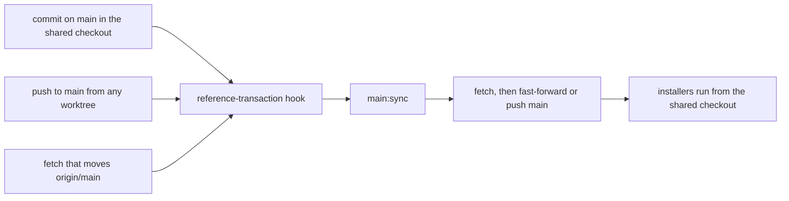

# Machine setup

`mise.toml` at the repository root sets up a Mac with
[mise bootstrap](https://mise.jdx.dev/bootstrap.html). It installs three
Homebrew packages and the repository's pinned development tools, copies shell, Git, and agent files from `setup/` into your
home directory, edits a few existing files, and adds mise's shell activation.

The values are the author's preferences. Fork the repository and change them
before you run it, and delete any entry you do not want. The agent plugins are
installed separately, as described in [Agent plugins](agent-pack.md).

## Requirements

- macOS on Apple silicon. mise skips `brew` packages on Intel Macs.
- [Homebrew](https://brew.sh), with the `brew shellenv` line its installer
  asks you to add to `~/.zprofile`. That line puts `/opt/homebrew/bin` on
  `PATH` and sets `HOMEBREW_PREFIX`, which `interactive.zsh` uses.
- [mise](https://mise.jdx.dev/installing-mise.html) and Git.
- [uv](https://docs.astral.sh/uv/getting-started/installation/) with a uv-managed
  Python 3.11 or newer. Follow uv's [Python installation instructions](https://docs.astral.sh/uv/guides/install-python/)
  before the first bootstrap. A system or Homebrew Python does not satisfy the
  managed-runtime requirement.

Check the runtime before applying setup:

```sh
uv run --offline --no-project --managed-python --python '>=3.11' --no-config --exclude-newer '3 days' python -V
```

mise installs the declared Homebrew packages into Homebrew's prefix, including
uv. It does not install the managed Python interpreter. The Claude policy task
runs offline and fails before applying that policy if the runtime is missing.
Other bootstrap resources may already have been applied at that point.

Tested with mise 2026.10.10 on macOS 26.5.1.

## Run it

```sh
git clone https://github.com/<you>/skills.git
cd skills
mise trust
mise bootstrap --dry-run
mise bootstrap
mise bootstrap status --missing
mise run agents:settings:status
```

`mise trust` is needed because `mise.toml` is a project file. The dry run lists
declared resource changes and prints the bootstrap task without running it.
`status --missing` checks bootstrap resources, not the policy applied by that
task. Use `agents:settings:status` to check Claude settings and instructions.
Open a new terminal afterwards to load the shell changes. Running
`mise bootstrap` again changes only what differs.

mise does not back up the files it overwrites. Copy the files listed below
before the first run, or set up
[dotfile history](https://mise.jdx.dev/dotfiles/history.html) first.

`mise.toml` also declares the repository's Actions analyzers and the Node.js
and uv versions that `npm test` uses. Run `mise install --locked` to install
them without applying the machine setup. Loading the
checkout puts installed tools on mise's activated `PATH` but declares no
environment variables.

## Keep installs level with origin/main

Three things should hold the same commit: `origin/main`, `main` in the
checkout you cloned, and what this machine installed from it. That checkout is
the shared checkout. Worktrees made from it with `git worktree add` share its
Git configuration and hooks. Turn the mechanism on once, from the shared
checkout:

```sh
mise run main:sync
mise run main:status
```

The first `main:sync` sets `core.hooksPath` in the repository's local Git
configuration to the shared checkout's `setup/git-hooks`. It stops instead
when `core.hooksPath` already points somewhere else. Add `-- --hermes` to also
create the Hermes operator profile described below.



From then on, Git runs `main:sync` whenever `main` or `origin/main` moves in
any worktree of the repository. `main:sync` fetches `origin/main`, then
fast-forwards the shared checkout to it or pushes the shared checkout's own new
commits without force. Then it runs each installer from the shared checkout:
`agents:sync`, `mise dotfiles apply`, `hermes:operator` when the operator
profile is installed, and `bb plugin install` for each bb plugin described
below. The command that moved the ref waits for the installers
and shows their output. A failed install never fails that command, and its
output names the failed step.

`main:sync` changes nothing and prints `STOPPED` with the reason in these
cases:

- The shared checkout needs to move and has uncommitted or untracked changes.
- The fast-forward would replace an ignored file, such as a local `.env`.
- Its `main` and `origin/main` each have commits the other lacks.
- It is on another branch.
- The push of its own commits fails.
- A commit or an edit lands in the shared checkout while the installers run.
  The message names the install that may hold the edit. A new commit starts
  its own run, which waits for this one and installs it.

It never resets, stashes, rebases, or force pushes. It fetches and pushes
`main` only, never tags. After you fix the cause,
the next commit, push, or fetch runs it again. Discarding the edits that
stopped it moves no ref, so run `mise run main:sync` yourself after that.
During a rebase of the shared checkout's `main`, it does nothing until the
rebase reattaches `main`, which runs it again.

`main:status` makes no changes. It asks the remote for `main` with
`git ls-remote`, then prints a row for `origin/main`, the shared checkout, each
agent package and settings target, each `mise.toml` dotfile entry that is not
applied, the Hermes operator profile, and each bb plugin from this
repository. It exits 1 and names the target when
any of them is behind. A merge made on GitHub shows as not fetched until the
next fetch or `main:sync` on this machine.

The `agents:*` tasks and `hermes:operator` still run alone. `hermes:operator`
reads the shared checkout even when you start it from another worktree. When
the tree an installer reads is not `origin/main`, it prints a warning that
names the gap, and `main:status` keeps reporting the gap until `main:sync`
runs. Installing unpushed work for a test is possible this way and stays
visible.

| Install target | Installed by | Kept level by `main:sync` |
| --- | --- | --- |
| Claude Code and Codex plugin packages, Claude settings and instructions, the preferences block in Hermes `SOUL.md` files | `agents:sync` | Yes |
| Dotfile entries in `mise.toml` | `mise dotfiles apply` | Yes |
| Hermes operator profile | `hermes:operator` | Yes, once installed |
| Bootstrap packages in `mise.toml` | `mise bootstrap` | No |
| bb plugins under `bb-plugins/` | `bb plugin install` | Yes, when installed from the shared checkout |
| CLIs under `tools/` | Each CLI's install step | No |

Claude Code reads the `ramtoshiya` and `ramtoshiya-cc` plugins straight from
the shared checkout, so a fast-forward changes them at once. Codex and Hermes
run copies, which the installers refresh. The Hermes profile also copies
skills from the pstack-mode checkout. A change there shows as drift in
`main:status` and installs at the next `main:sync`.

bb neither rebuilds a path plugin on `bb plugin reload` nor records which
source a build read. `main:sync` therefore reinstalls each plugin installed
from `bb-plugins/<id>` in the shared checkout whose folder changed since its
last install there. It runs `npm ci --ignore-scripts` first when the folder has
a `package-lock.json`, because the bb build bundles packages from
`node_modules`, and then `bb plugin install --yes`. It records the installed Git tree
in `~/.local/state/ramtoshiya-agents/bb-plugins.json`, so a plugin with no
record yet installs once on the next run. A reinstall restarts the plugin's
provider worker. While a turn on that provider is running, `main:sync`
postpones the plugin and reports it as a failed step. Run `mise run main:sync`
after the turn finishes.

`main:status` reports a bb plugin as drift when bb runs it from anywhere else.
That covers a worktree of this repository and the `preserved-source` copy bb
makes when it removes a worktree a plugin was installed from. The row names the
`bb plugin install path:<shared checkout>/bb-plugins/<id> --yes` command that
moves it and keeps its settings. `main:sync` never moves a plugin by itself.

## Check GitHub Actions

From the checkout, run:

```sh
mise install --locked
mise run actions:check
mise exec -- node --test dev/tests/repository/actions-checks.mjs
```

The checks use [actionlint](https://github.com/rhysd/actionlint) for workflow
syntax, schemas, and action contracts, and
[zizmor](https://docs.zizmor.sh/) for Actions security. Run them separately with
`mise run actions:syntax` and `mise run actions:security`. Both return nonzero
on findings. The focused tests exercise each task against a bad workflow and
check that its diagnostic reaches the caller. They need Node.js and Git.

The versions in `mise.toml` are exact. `mise.lock` records download URLs,
SHA-256 checksums, and provenance verification for Linux x64 (CI) and Apple
silicon macOS. Other platforms need lock entries before using `--locked`.
When updating tools or actions, verify the official release date and wait at
least 72 hours, even for an exact pin. mise's minimum-release-age setting does
not filter exact versions. Refresh the lock with `mise lock --platform
linux-x64,macos-arm64`, then rerun the checks and tests.

`actionlint` releases less frequently than the Actions ecosystem changes.
Passing it does not prove that an action is current, supported, or secure.
Check releases and advisories in the original repositories when updating
SHA pins, and keep version comments beside each `uses:` entry.

The security task runs zizmor offline, removes GitHub token variables and
`RUST_LOG`, and uses no verbose or debug logging. It does not perform online
advisory or repository audits. Review advisories separately when updating
pins. Do not use zizmor 1.27.0, whose debug logs can expose credentials
([GHSA-f42p-wjw5-97qh](https://github.com/zizmorcore/zizmor/security/advisories/GHSA-f42p-wjw5-97qh),
fixed in 1.28.0).

`.github/workflows/actions-check.yml` runs the same checks for pushes and pull
requests with read-only permissions. It uses a SHA-pinned mise action, an
exact mise release, and locked tool downloads, without applying dotfiles or
Homebrew setup. Its security step runs even if the syntax check fails.
`.github/workflows/test.yml` runs `npm test` on macOS for pushes and pull
requests with the same permissions, action pins, and locked tools. Run the
same suite locally with `mise exec -- npm test`.
The upstream fork drift workflow keeps issue-write permission only for its
existing reporting job. Checkout does not persist credentials, and setup-node's
automatic package-manager cache is disabled there.

## What it changes

Packages, installed with mise's `brew` manager:

- `jq`, used by the Claude Code status line.
- `uv`, which runs the agent hooks and the review launcher.
- `zsh-autosuggestions`, loaded by `interactive.zsh`.

Shell:

| Target | Change |
| --- | --- |
| `~/.config/shell/environment.zsh` | Copy of `setup/shell/environment.zsh`. Adds `~/.local/bin` to `PATH` and sets `IMPECCABLE_NO_TELEMETRY=1`, which turns off telemetry in the [Impeccable](https://impeccable.style) design skills. In bb agent threads, where `BB_THREAD_ID` is set, it also sets `IMPECCABLE_QUESTION_DISABLED=1`, so Impeccable's design questions and plan reviews happen in the thread instead of on a page that only this Mac can open |
| `~/.config/shell/interactive.zsh` | Copy of `setup/shell/interactive.zsh`. Puts `~/.local/bin` first in `PATH`, sets `HOMEBREW_CLEANUP_MAX_AGE_DAYS=30` and `GPG_TTY`, and loads zsh, uv, and uvx completions and zsh-autosuggestions |
| `~/.zshenv` | A block that sources `environment.zsh` |
| `~/.zshrc` | A block that sources `interactive.zsh`, then mise's activation block |
| `~/.zprofile` | mise's shims block |

Package managers. Each one skips releases newer than three days:

| Target | Change |
| --- | --- |
| `~/.npmrc` | The line `min-release-age=3` |
| `~/Library/Preferences/pnpm/config.yaml` | `minimumReleaseAge: 4320` (minutes) |
| `~/.config/uv/uv.toml` | `exclude-newer = "3 days"` |
| `~/.config/mise/config.toml` | `minimum_release_age = "3d"` under `[settings]` |

Git:

| Target | Change |
| --- | --- |
| `~/.config/git/shared.gitconfig` | Copy of `setup/git/shared.gitconfig`: aliases, diff, merge, fetch, push, pull, and rebase preferences, `rerere`, and `core.excludesfile = ~/.gitignore` |
| `~/.gitconfig` | A block that includes `shared.gitconfig` |
| `~/.gitignore` | The lines `.DS_Store` and `**/.claude/settings.local.json` |

`shared.gitconfig` turns on `core.fsmonitor` and `core.untrackedCache`. Check
that your file system supports them with `git update-index --test-untracked-cache`
before you keep them.

Agents:

| Target | Change |
| --- | --- |
| Registered Claude profiles' `CLAUDE.md` | A managed block from `setup/agents/preferences.md`, preserving text outside the block |
| `~/.codex/AGENTS.md` | A copy of `setup/agents/preferences.md` |
| `~/.bb/AGENTS.md` | A copy of `setup/agents/bb-agents.md`, which the bb app adds to the instructions of every agent thread it starts |
| `SOUL.md` in `~/.hermes` and in each profile under `~/.hermes/profiles/` | A managed block from `setup/agents/preferences.md`, preserving text outside the block |
| Registered Claude profiles' `settings.json` | Common keys from `setup/agents/claude-settings.json`, with terminal defaults from `setup/agents/claude-terminal-settings.json` only for `~/.claude` |
| `~/.claude/status-line.sh` | Copy of `setup/agents/claude-statusline.sh` |
| `~/.local/bin/claude-review` | Copy of `setup/agents/claude-review`, an executable shell script that starts the review launcher |
| `~/.local/share/claude-review/claude-review.py` | Copy of `setup/agents/claude-review.py`, the review launcher and its hook handler |
| `~/.local/bin/quotio-cli` | Copy of `setup/agents/quotio-cli`, an executable shell script that runs the command-line helper inside the [Quotio](https://github.com/nguyenphutrong/quotio) app from `/Applications`. The shared `worker-routing` policy uses it for weekly quota outside BB and as a fallback for BB's Provider usage RPC. Setup does not install Quotio, and without it the script exits with an error |

The managed plugin synchronization workflow reads host selections from
`setup/agents/hosts.json`. Both humanizers are paused on Claude Code and
selected together on Codex so Korean delegation has an installed
target. Add `claude` back to both entries and run the sync to resume them. This
policy file does not install plugins during `mise bootstrap`.

The shared instructions distinguish missing configuration and invalid or incompatible
tools from an absent installation. They direct agents to inspect documented trusted
locations and report unresolved searches before concluding a prerequisite is missing.

For feasibility questions, the shared instructions ask agents to demonstrate or
attempt the stated requirement and report fragile routes with their costs.

The coding-agent instructions authorize local commits of completed, validated
task-owned changes on the current branch, including the default branch. They
protect unrelated changes and respect explicit no-commit requests. Tasks that
need isolation use a separate worktree before implementation, not a branch
switch in the shared checkout. Local commit permission does not authorize
pushing, publishing, or destructive history changes. When a task does authorize
a push and the branch has diverged, the agent puts only its own commits on the
current remote branch, reruns the checks, and pushes without force. It asks
only for a decision the commits do not settle, a history rewrite, a change to
someone else's work, or a check it cannot fix within the task. The
instructions also require completing necessary authorized follow-up steps and
removing task-owned experiments, including temporary files and test sessions,
before reporting completion.

They state that checks, hooks, and guards exist to catch mistakes, including an
agent's habitual shortcuts such as suppressing a lint rule. Deliberate bypass,
such as `git commit --no-verify`, is out of scope for them. A check that fails
and then passes on a rerun counts as a defect to fix or report, not a pass.

Every agent, including the Hermes operator, follows one delegation rule. It
owns the goal and how it is checked, delegates large reads, searches, and
fixed-scope implementation to cheaper models, and does small work and
judgement itself. Before it starts a worker it follows the `worker-routing`
skill described in [Agent plugins](agent-pack.md). A stricter role
instruction, such as the operator's rule never to implement, wins.
After a compaction it rereads in full the mode and skill files its brief or
task named before it starts another worker or edits a file.

The instructions also ask agents to end nontrivial work with a claim
checklist: each claim, its evidence, and a confidence. When a user or reviewer
pushes back, the agent checks the challenge against that checklist and changes
only what the evidence shows is wrong. This follows the Thinking-in-Bets method
in [arXiv:2610.34654](https://arxiv.org/abs/2610.34654), which found that a
record written before feedback keeps agents from undoing correct work, while
the same record written after feedback helps little.

When an agent builds or starts a web UI or development preview for your own
use, the instructions have it listen on loopback and on the addresses
`tailscale ip` reports, so the tool also works from your other Tailscale
devices without a separate request. If the server cannot listen there, the
agent keeps it on loopback and adds a tailnet-only `tailscale serve` mapping
instead. Agents do not bind every interface, enable Funnel, or change tailnet
access rules to make a tool reachable. Test fixtures, OAuth callbacks, credential-holding
services, and anything you ask to keep local stay on loopback. Without a
running Tailscale, the tool stays on loopback and the agent says that other
devices cannot reach it. The
[personal web access cases](../dev/evals/personal-web-access/cases.json) check
that behavior in fresh Claude Code and Codex sessions. Run them with
`node dev/evals/personal-web-access/run.mjs <new-output-directory>` and grade
each reply against its assertions.

The bb instructions give agents in bb threads standing permission to start the
worker threads their workflow calls for, such as reviewers, judges, and arena
candidates, as visible child threads. bb's own introduction tells agents not to
start threads unless the user asked, and without this file a worker either asks
every time or runs those roles itself. Messages to unrelated threads are not
covered.

`claude-settings.json` sets these Claude Code preferences:

- `includeGitInstructions` is false, which disables Claude Code's built-in
  commit and pull request workflow instructions. The shared agent instructions
  define the local commit workflow instead. This setting does not override
  higher-priority instructions supplied by a host or harness.
- `enableArtifact` is false, which disables the Artifact tool.
- `disableBundledSkills` is true, which removes bundled skills and workflows
  and hides built-in slash commands from the model. Built-in commands remain
  typable. Plugin skills and local skills and commands are unaffected.
- `syncClaudeAiSkills` is false, which stops syncing and loading standalone
  claude.ai skills such as `pptx`, `xlsx`, and `google-workspace`. On the next
  startup, Claude Code moves previously synced copies from `~/.claude/skills/synced/`
  to `~/.claude/skills/.trash/`. This preference must be applied to user settings.
  Claude Code does not read it from the project's `.claude/settings.json`.
- `syncClaudeAiPlugins` is false, which separately stops syncing and loading
  plugins from the claude.ai account. On the next startup, Claude Code moves
  previously synced copies to `~/.claude/plugins/.trash/`.
  Marketplace plugins and local skills are unaffected by either setting.
  Neither setting removes anything from the claude.ai account. See the
  [plugin loading reference](https://code.claude.com/docs/en/plugins/loading.md).
- Automatic memory, prompt suggestions, away summaries, and feedback surveys
  are off.
- `attribution.commit` and `attribution.pr` are empty and
  `attribution.sessionUrl` is false, so Claude Code stops asking the model to
  add a co-author trailer, a "Generated with Claude Code" footer, or a session
  link.
- `autoCompactWindow` is 300000, so Claude Code compacts the conversation on
  its own as it nears 300,000 tokens. The context budget hook in
  `ramtoshiya-cc` reads this number and asks the agent to compact earlier, from
  75% of it. See [Hooks](hooks.md).
- `CLAUDE_CODE_DISABLE_OFFICIAL_MARKETPLACE_AUTOINSTALL=1` stops Claude Code
  from registering the official marketplace on its own. It does not remove a
  marketplace that is already registered.
- `permissions.deny` includes `AskUserQuestion`, `EnterPlanMode`, and
  `SendFeedback` in every registered Claude profile. Necessary questions stay
  in ordinary chat, where the user's reply can serve as a fork or rewind
  checkpoint in T3 Code. This is an interaction preference, not a terminal
  permission-approval mode. Shared instructions also require leaving plan mode
  if a session starts there. Preserving an existing profile permission field
  does not override those instructions.
- `permissions.deny` also includes `EnterWorktree` in every registered Claude
  profile. This blocks entry through Claude Code's tool, which activates its
  worktree isolation guard and restricts commands against other checkouts.
  Use `git worktree` or the host's worktree features when isolation is needed.
  Those paths are not blocked by this rule.

`claude-terminal-settings.json` applies only to `~/.claude`:

- `permissions.defaultMode` is `bypassPermissions`, which skips permission
  prompts. Change this if you want prompts.
- The status line shows the model, effort, and context use, refreshed every
  second. If `~/.orca/agent-hooks/claude-statusline.sh` exists, it also receives
  the input. Otherwise that step does nothing.

## Keep Claude profiles consistent

Use the ordinary `~/.claude` configuration for terminal and hosted Claude Code
sessions when they should share preferences and plugins. For GPT routing through
[claudex](../tools/claudex/README.md), select that executable in the host. It
sets the provider and models for each launch without a separate Claude
configuration directory.

In T3 Code, set the Claude provider's `Binary path` to `claudex` or its full
installed path. Set `CLAUDE_CONFIG_DIR path` to the absolute path of your
`~/.claude` directory when you need to override an inherited value. Leaving
that path blank inherits the host environment and does not prove the default
directory is in use.

An intentionally isolated instance can use a separate `CLAUDE_CONFIG_DIR`,
which has its own user settings and does not inherit `~/.claude/settings.json`.
Register such directories to reconcile their common settings:

```sh
mise run agents:settings:status
mise run agents:settings:sync
mise run agents:settings:status
```

These tasks check or apply settings and common instructions without running
plugin commands or model requests. They always include `~/.claude`, regardless
of the caller's `CLAUDE_CONFIG_DIR`. They also check or apply the common
instructions in every Hermes profile, as the Hermes operator profile section
describes. Add `-- --host claude` or `-- --host hermes` to either task to check only
one of them. The ordinary `agents:status` and
`agents:sync` tasks also include these checks when Claude is selected, unless
`--plugin` limits the command to packages. Use `--json` for machine-readable
results. Each profile has separate settings and instructions results.

`mise bootstrap` runs `agents:settings:sync` through its bootstrap task, after
dotfiles and tools. All Claude policy writes therefore use the same registry,
overrides, and merge rules. There are no separate Claude settings merges or
instruction copies in `[dotfiles]`. `mise dot apply`, `mise bootstrap status`,
and `mise bootstrap --dry-run` do not execute the policy task.

Keep the target list in
`~/.config/ramtoshiya/claude-profiles.json`, or
`$XDG_CONFIG_HOME/ramtoshiya/claude-profiles.json`:

```json
{
  "version": 1,
  "profiles": {
    "isolated": {
      "configDir": "~/.claude_isolated"
    },
    "worker": {
      "configDir": "~/.claude_worker",
      "overrides": {
        "env": {
          "CLAUDE_CODE_ENABLE_AWAY_SUMMARY": "1"
        }
      }
    }
  }
}
```

Names are labels. Each entry needs an absolute path or a `~/` path. Two entries
cannot name the same resolved directory. An entry naming `~/.claude` still gets
its terminal defaults. `overrides` records intentional differences after the
common settings and terminal defaults. The checker reports override key names
so an exception does not look like common-policy coverage. Keep this registry
outside the repository and keep credentials in the provider's own settings.
The registry controls settings reconciliation only. It does not select a
launcher or install plugins into registered directories.

Only settings named by the common source, terminal defaults, or an explicit
override are managed. Nested objects keep unrelated keys. Required array entries
are added without removing existing entries, so an override can add deny rules
but cannot remove common ones. Authentication, provider routing, plugins, hooks,
and permission keys outside the managed policy are left alone unless explicitly
included in an override. Terminal approval mode and status-line defaults are
not copied to alternate profiles. Correct files are not rewritten. A setting
removed from a source is no longer managed, but is not deleted from existing
targets.

The same profile inventory supplies `setup/agents/preferences.md` to each
profile's `CLAUDE.md`, between `<!-- BEGIN ramtoshiya:preferences -->` and
`<!-- END ramtoshiya:preferences -->`. Sync adds or updates only this block and
preserves existing text outside it. Missing blocks are drift. Duplicate or
unpaired markers are conflicts and the affected file is not overwritten.
Instruction contents are not printed in diagnostics. Existing standalone
instructions outside the block remain local content, even if they repeat the
common source.

A profile name is a label, not an instruction to change a provider's
environment.

Both commands report unregistered directories found at `~/.claude*/settings.json`
and an unregistered active `CLAUDE_CONFIG_DIR`, including one outside the home
directory. They exit nonzero and leave those directories untouched, even if no
launcher uses them. Detection is not a complete inventory of every host. When
creating an isolated instance, register its custom location rather than relying
on discovery. Invalid JSON and configuration conflicts also return nonzero.
Diagnostics show paths and key names, not settings values.

Classify a setting by the behavior it controls before assigning its scope.
Common interaction rules, terminal display and approval settings, role-specific
memory behavior, and project rules need not share a scope even when their keys
have the same JSON parent. Keep regression expectations tied to the intended
behavior, not only to values computed from the current source.

After changing common settings or instructions, run sync and status across the
registry. After adding an instance, changing its launch configuration, or
updating Claude Code or its host, start a fresh session through that instance's
real launcher. Check the environment relevant to configuration and routing,
including `CLAUDE_CONFIG_DIR`, without exposing credentials. Check that
`AskUserQuestion`, `EnterPlanMode`, and `SendFeedback` are unavailable, Artifact
and bundled skills are absent, expected plugins and their skills are visible,
and common instructions load. Use `/model` and the proxy or provider's
diagnostics to check the selected model and where a request is sent. In T3
Code, confirm that necessary questions use ordinary chat and that the user's
reply is a usable fork or rewind checkpoint. Check worker memory behavior
against its role separately.

Launch arguments, environment variables, project settings, and host-supplied
instructions can change effective behavior. A successful file check does not
prove what a running session has loaded. Report file checks, fresh-launch
checks, and host-level checkpoint checks separately, including any that were
not performed.

## Review launcher

`claude-review` starts `claude` with a time budget for each turn. A program
that starts Claude Code from a configured executable path, such as the Claude
"Binary path" setting in T3 Code, can use `~/.local/bin/claude-review` as that
path. The `PATH` the program passes must contain `uv` and `claude`. A lone
`--version`, `--help`, or their short forms runs `claude` unchanged.

Claude Code keeps only the last `--settings` flag, so the launcher removes every
`--settings` option in front of a `--` argument and merges the values in order
into one object. A value is inline JSON or the path of a JSON file. Later keys
win, and `env` merges key by key. The launcher appends three command hooks to
the `hooks` the caller set, then runs `claude` with the merged object as the
only `--settings` flag, followed by the other arguments in their original
order. A value that is not a JSON object, a file that cannot be read, or an
`env` that is not an object makes the launcher print one line that starts with
`claude-review: ` and exit with 1 before it starts `claude`. The line does not
repeat the value.

| Variable | Default | Meaning |
| --- | --- | --- |
| `CLAUDE_REVIEW_WARN_MINUTES` | 20 | Minutes into a turn after which the model gets one reminder |
| `CLAUDE_REVIEW_MINUTES` | 30 | Minutes into a turn after which tool calls are refused |

Both accept decimals. A value that is not a number, a value of 0 or less, or a
warning time that is not below the budget stops the launch with exit code 1.
The launcher sets the resolved values in the environment it gives `claude`, so
the hooks read the same numbers.

The hooks keep one clock for each session:

| When | Effect |
| --- | --- |
| A prompt arrives, including the one Claude Code sends when a background subagent finishes | The clock restarts, and the reminder and the refusal start over |
| A tool call finishes after the warning time | The model gets one note with the minutes used. It says to finish the current check and write the report |
| The first tool call after the budget | The call is refused. The reason tells the model to write its report from what it has |
| Each later tool call | The call is refused, the turn ends, and the session waits for the next prompt |

The hooks fire only when the model calls a tool. They cannot interrupt a call
that is running or a reply that has no tool call. Calls from subagents count
against the clock of the session that started them. A hook that fails prints one
line to stderr and lets the call go ahead. Each clock is a file under
`claude-review/` in the system temporary directory.

## Hermes operator profile

`mise run hermes:operator` sets up a [Hermes Agent](https://github.com/NousResearch/hermes-agent)
profile named `operator` for conversation only. You talk to it in a bb thread
with the `acp-hermes-agent` provider. It remembers, discusses, and writes
briefs. When you ask for an implementation task or a skill change, or agree to
one in conversation, the operator starts a coding agent on it as a running bb
thread under the operator's thread. Your agreement approves the whole outcome,
including the integration, installation, and verification it needs, so the
operator sends unfinished steps back to the same worker instead of asking
again. Held drafts, which wait until you send them, are only for skill changes
that Hermes's automatic background skill review proposes.
`mise bootstrap` does not run this task.

It needs:

- Hermes Agent with its `hermes` command on `PATH`.
- A Git checkout that contains `plugins/pstack-mode/mode.md` and
  `plugins/pstack-mode/skills/`, at `~/workspaces/pstack-mode` by default. Pass
  another path with `mise run hermes:operator -- --pstack <path>`. Workers read
  its `mode.md`, and the profile gets seven of its skills.
- The third-party sources at their pinned commits, which
  `mise run agents:sync` fetches. The task stops and says so when one is
  missing.
- bb with the [held-drafts](../bb-plugins/held-drafts/README.md) plugin, which
  provides `bb draft create` for background skill-review proposals.

The profile gets every skill that Claude Code or Codex gets from
`.claude-plugin/marketplace.json`: both of this repository's plugins,
including the Claude Code-only `ramtoshiya-cc`, and the skills each
third-party entry selects. pstack-mode is the exception and contributes only
the seven skills above. Knowing a skill lets Hermes plan around it and name it
in a brief. It does not let Hermes do the skill's work, because the
operator-handoff skill sends anything beyond conversation and reading to a
coding agent. The exception is `self-compact`, which Hermes follows
through the `self_compact` tool described below. An entry that ships a native Hermes plugin (a `plugin.yaml`,
such as `humanize-korean`) is installed as that plugin, and Hermes loads its
skills as `<plugin>:<skill>`, such as `humanize-korean:humanize-korean`. The
plugin's `name` must match its marketplace entry, or the task stops. Hermes's
own bundled skills are deleted, as the next sections describe.

The task creates the profile with `hermes profile create operator --no-skills`
if it is missing and makes it the default with `hermes profile use operator`.
Then it changes these files under `~/.hermes/profiles/operator/`:

| Target | Change |
| --- | --- |
| `SOUL.md` | A block from `setup/hermes/soul-operator.md` between `<!-- BEGIN ramtoshiya:operator -->` and `<!-- END ramtoshiya:operator -->`, after the Hermes default text. The shared preferences block next to it comes from `mise run agents:settings:sync`, described below |
| `skills/<skill>/` | A copy of the files Git tracks in each skill, and of `setup/hermes/skills/operator-handoff` with this machine's paths and the list of plugins filled in. The task replaces these folders on every run |
| `skills/` | Hermes's bundled skills deleted. Other skills stay |
| `plugins/<entry>/` | The files Git tracks in each marketplace entry that is a native Hermes plugin |
| `plugins/skill-drafts/` | A copy of `setup/hermes/plugins/skill-drafts` and a `sources.json` that maps each skill to the checkout and, for a third-party skill, the fork and commit it came from. The plugin keeps its evidence packets and proposal record in the profile's `skill-drafts/` folder, which a reinstall leaves alone |
| `plugins/bb-thread-env/` | A copy of `setup/hermes/plugins/bb-thread-env` |
| `plugins/self-compact/` | A copy of `setup/hermes/plugins/self-compact` |
| `config.yaml` | The settings below, and the plugins enabled |

| Setting | Value | Effect |
| --- | --- | --- |
| `agent.disabled_toolsets` | `["file", "code_execution", "delegation"]` | No file reading or writing tools, no code execution, and no `delegate_task` subagents, which bb cannot show. The operator starts every worker as a bb thread instead. The terminal stays on for `bb` |
| `skills.auto_load` | `["operator-handoff"]` | The handoff procedure is in every session |
| `skills.project_discovery` | `true` | Project skills load only from trusted repositories |
| `skills.external_dirs` | The `.hermes/skills` and `.agents/skills` folders of each repository in `skills.trusted_project_dirs` | Every operator session loads the trusted repositories' current skills, also in a bb worktree. Hermes alone loads them only when the session's nearest `.git` is the trusted checkout itself, and a worktree's branch can hold an older copy. After `hermes -p operator skills trust <path>` or `untrust`, run the task again |
| `curator.enabled` | `false` | Hermes does not archive or merge skills on its own |
| `memory.write_approval` | `false` | Hermes writes its built-in memory without asking. Memory limits stay at the defaults |
| `compression.threshold_tokens` | `300000` | Hermes compresses a session on its own when a request reaches 300,000 tokens. The self-compact plugin reminds the agent to compact from 75% of this number |

Running the task again replaces the copies it manages, removes skills that
the marketplace no longer selects, and leaves memories, sessions,
credentials, and other settings alone. It reports any other skill it finds in
the profile's `skills/` and leaves it in place.

A running Hermes gateway keeps the plugin code it imported, and enabling an
already enabled plugin does not reload it. So after copying and enabling the
plugins, the task runs `hermes -p operator skill-drafts reload`, a command the
`skill-drafts` plugin adds. It asks the gateway that serves the profile to
import the profile's current plugin files. Other profiles and open sessions
keep running. When no gateway runs, the next one to start loads the new files.
When the gateway refuses, the task fails and prints the gateway's reason, and
the profile's sessions keep the previous plugin code until that gateway
restarts. Run the same command after copying plugin files by hand.

After installation, the task runs `hermes -p operator sessions refresh-prompts`.
Continuing sessions otherwise reuse their stored system prompts, even after
SOUL.md or skill files change. Each session adopts the installed instructions
on its next turn and keeps its history and session id. The refresh costs one
prompt-cache miss for every stored session of the profile. A failed refresh
fails the task rather than reporting that existing sessions are up to date.
Run the same refresh command after changing prompt files by hand.

The task records what it installed in
`~/.local/state/ramtoshiya-agents/hermes-operator.json`, under
`$XDG_STATE_HOME` when that is set. When neither its sources nor the installed
files changed since that record, it skips the whole install, so the gateway
reload and the prompt refresh do not run. Running sessions are then left
alone. `--check` compares without installing and exits 1 with the reason when
the profile is out of date.

The auto-loaded `operator-handoff` skill requires a current thread query before
reporting task status, execution environments, or work order. Corrections also
recheck the factual premises of the earlier advice. Creation receipts are
snapshots, and a held draft's requested worktree does not exist until the draft
is sent.
Separate worktrees allow parallel work even when both results target `main`.
When an approved worker stops short, the operator checks the brief it sent,
says whether its own brief imposed the stop, and sends the rest back to that
worker. A diverged branch also goes back to the worker, which waits for any
other thread that is integrating the same branch. New scope, new authority, a
shared-resource conflict that waiting does not resolve, or a failed safety
check still goes to you first.
For BB customizations, the shared BB instructions and operator handoff direct
agents to supported settings or plugins. An application fork, personal core
patch, or installed bundle patch requires an explicit request for that route.
If supported settings and plugins cannot deliver the behavior, the operator
states the limit and surfaces the upstream request or bug report route.
Before starting a worker, the operator asks in conversation when an unresolved
choice would change the requested outcome or consequential change targets. It
decides incidental implementation choices itself and reports the target of
each worker.
Finding a different owner does not by itself authorize changing that target.
A direction you set changes only after the operator asks you with evidence. A
direction nobody decided may run as a proposal experiment that changes no
default route until you decide. A direction you rejected stays out of briefs
and worker messages unless the operator raises it again as a question with new
evidence. Before relaying a worker's claim that a step is required or that
something does not exist, the operator checks it against the goal and what is
already known. The operator writes no files, so a worker writes any image page
into the operator's thread storage for the operator to show in chat.
The [operator verification cases](../dev/evals/hermes-operator/cases.json)
exercise these distinctions in live Hermes sessions. These are behavioral
checks, separate from the installer's deterministic prompt-refresh tests.

The operator and every other Hermes profile get the shared preferences from
`setup/agents/preferences.md`, the same text Claude Code and Codex get. Hermes
loads a profile's `SOUL.md` into every session of that profile, so
`mise run agents:settings:sync` keeps a block between
`<!-- BEGIN ramtoshiya:preferences -->` and `<!-- END ramtoshiya:preferences -->`
in the `SOUL.md` of `~/.hermes` and of each profile under `~/.hermes/profiles/`.
It changes nothing else in those homes. `mise run agents:settings:status`
reports a missing or outdated block as drift. A profile without a `SOUL.md`
is a conflict and is left alone, because Hermes writes its default `SOUL.md`
only when the file is missing. Start Hermes once with that profile, then sync
again. `mise run main:sync -- --hermes` runs the sync again after it creates
the profile.

### Bundled skills

Hermes copies its bundled skills into a profile's `skills/` at every chat
start, every gateway start, and every `hermes update`. After
`hermes skills opt-out` it copies only `hermes-agent`, which it treats as
essential. It never copies back a bundled skill that `skills/.bundled_manifest`
lists but the disk lacks, because it treats that skill as deleted by the user.
So the task does this in the operator profile and in the base `~/.hermes`:

1. Runs `hermes skills opt-out`.
2. Runs `hermes skills reset hermes-agent --restore --yes`, so the manifest
   lists `hermes-agent`.
3. Deletes every folder in `skills/` that holds a skill the manifest lists,
   except the skills the task installs, and keeps the manifest.

Hermes then adds no bundled skill back. Without `hermes-agent`, Hermes tells
the model to use its online documentation for questions about Hermes itself.

A Hermes release that adds another essential skill adds it once. Run
`mise run hermes:operator` after `hermes update` to delete it. Do not run
`hermes skills opt-out --remove` in these homes, because it empties the
manifest and Hermes then adds `hermes-agent` back at the next start.
`hermes skills reset <name> --restore --yes` restores one bundled skill, and
`hermes skills opt-in --sync` restores all of them, in the profile they run in.

### What bb lists for Hermes

bb's shipped `acp-hermes-agent` provider starts `hermes acp`, which runs in
the profile that `hermes profile use` set. Its skill menu lists
`~/.hermes/skills/` and the `skills.external_dirs` in `~/.hermes/config.yaml`,
whatever profile the session runs in. So the task replaces that provider with
an entry whose id is `hermes-agent` in the ACP providers plugin's
`customAgents` setting:

- It starts `hermes -p operator acp`.
- Its skill menu adds the operator's `skills/` and each native plugin's
  `hermes/skills/` with the `<plugin>:` prefix. bb lists
  `humanize-korean:humanize-korean`, the name Hermes loads it by. It also
  adds the trusted repositories' skill folders that the operator loads, when
  they are inside your home folder, because bb takes only home-relative roots.
- It sets reasoning through Hermes's `reasoning_effort` option.
- It turns on manual compaction, which bb's shipped entry leaves off, so
  `bb thread compact` works for Hermes threads. Hermes runs the `/compact` it
  receives as its own `/compress`.

The task keeps every other custom agent and replaces only an earlier
`hermes-agent` entry. When `bb` is not on `PATH`, it skips this step and says
so. bb still lists `~/.hermes/skills/` for the entry, which is why the base
`~/.hermes` loses its bundled skills too. Picking a skill in the menu sends
`/<skill>` to Hermes as plain text, which the model reads as a request to
load that skill.

Adding the operator's skills to the base `skills.external_dirs` instead would
make every session in the base profile load them, and `humanize-korean` would
load a second time without its prefix.

Unlike the shipped provider, the custom entry cannot fork a Hermes thread in
bb, shows a generic icon and sign-in hint, and has no `none` level in the
reasoning menu. To return to the shipped provider, remove the `hermes-agent`
entry on the ACP providers plugin's settings page.

### How a change reaches a skill

The installed skills are copies, so a local edit would drift from its source.
The `skill-drafts` plugin blocks every `skill_manage` call. When the operator
itself calls it, the plugin tells the operator to write the brief and start a
worker as `operator-handoff` describes once you agree to the change, because
only the operator knows why the skill fell short. A skill change you ask for in
conversation runs the same way, without a draft.

After some turns, Hermes reviews the conversation in the background. The
operator profile asks the reviewer to propose skill changes only for an
explicit standing correction from the user or a skill gap that caused a wrong
result, a missed requirement, or substantial rework. The reviewer can finish
without a proposal. Hermes never stores that review's messages, so the plugin
keeps the reviewer's text from each of its model responses. If the reviewer
calls `skill_manage`, the plugin starts one analyst thread for all of those
calls after the review ends:

- It writes an evidence packet to
  `~/.hermes/profiles/operator/skill-drafts/proposals/<id>/`. `evidence.md`
  has each blocked call, a diff against the installed copy, the owning source,
  the reviewer's messages, known gaps, and earlier reviews for the same skills.
  `session.jsonl` is an export of the stored conversation.
- It starts the analyst with `bb thread spawn` in the personal workspace, on
  `claude-code` with the highest-numbered Opus model at `high` effort. When
  the bb thread that shows the session is known, the analyst is its child.
- The analyst decides whether the evidence supports a change. If it does, the
  analyst writes a brief with a confidence and gaps section and creates a held
  draft titled `Skill change: <skills>`, parented to the same operator thread.
  If the held-drafts plugin's `mode` is not `draft`, it creates no draft and
  reports the brief instead. A worker started by sending the draft makes the
  change at the source and pushes it to `origin/main`. The push refreshes the
  copies, as the section on keeping installs level describes. A third-party
  skill is changed in its fork and the pin updated, as
  [Third-party skills](upstream-skills.md) describes.
- When the analyst finishes, the operator reports its decision and archives
  it. The draft stays, because it is the analyst's sibling.

A review that sends no final response is handed over after 10 quiet minutes,
and its packet says the closing summary is missing. Unloading the plugin hands
over every review in progress. A proposal whose operations and installed files
match one an analyst received in the last 14 days starts no second analyst.
The record is `skill-drafts/ledger.json` in the profile. When the analyst
cannot start, the plugin logs a warning in the gateway log and tells the
operator thread, which tells the user. A later review that proposes the same
change tries again. A session with no bb thread gets a top-level analyst and
draft. A gateway that stops during a review loses that review's proposals.
The skill files never change in any of these cases.

For other work, the `operator-handoff` skill tells Hermes how to write a brief
and start the worker with `bb thread spawn --parent-self` in a new worktree.
Hermes passes each worker, draft, and research thread a provider, model, and
reasoning level chosen by the `worker-routing` policy, so bb does not fall
back to its remembered or default settings. Drafts are held while the
held-drafts plugin's `mode` setting is `draft`. Setting it to `direct` sends
new drafts immediately.

When a child thread reports back, the skill has Hermes read the full output
and then archive the child in the same turn, so finished workers leave the
sidebar without a separate cleanup request. Hermes first checks the child and
all its descendants again. It keeps a child whose output is a question, error,
or partial result. It also keeps one that is not idle, has queued messages,
has a Git workspace with uncommitted changes, or whose workspace is still
needed for review or integration. Archiving keeps the history and archives
every descendant. bb removes a managed worktree after a grace window but keeps
its branch. This is an instruction Hermes follows, not a background job. A
child whose result arrives while no operator session handles it stays until a
session reads it. Workers that a coding agent starts for its own workflow are
archived by that agent, as `setup/agents/bb-agents.md` and the
`worker-routing` skill instruct.

The terminal can still edit files, so keeping Hermes to conversation relies on
`SOUL.md` and the skill.

### How a session knows its bb thread

bb starts `hermes -p operator acp` with `BB_THREAD_ID` and the other `BB_*` variables,
but that process only shows the session. Commands run in the shared Hermes
gateway, which has no `BB_*` variables. The `bb-thread-env` plugin sets
`BB_THREAD_ID` for each command a session runs. It reads the id from the env
of the session's `bb-bridge` MCP server, which bb creates for each thread and
Hermes keeps with the session. It never exports the bridge's host, port, or
token. It unsets `BB_PROJECT_ID`, `BB_ENVIRONMENT_ID`, and `BB_THREAD_STORAGE`,
because the `bb` CLI finds them from the thread id.

With `BB_THREAD_ID` set, `bb status` names the operator's thread. The
`operator-handoff` skill starts each worker with `--parent-self` and parents
each held draft with `bb thread update <id> --parent-thread "$BB_THREAD_ID"`,
so the operator receives each worker's completion message.

The plugin reads the server list from the gateway's in-memory session state,
which Hermes does not document for plugins. If `bb status` in an operator
session shows `Thread: (not set)` after a Hermes update, check that state first.

### How a session compacts itself

The `self-compact` plugin runs the shared `self-compact` skill for operator
sessions in bb, as Claude Code's context budget hook does for Claude Code.

- After each model request it records the session's context size. From 75% of
  `compression.threshold_tokens`, it reminds the agent once per five-point
  band to compact at the next natural boundary. The reminder starts over after
  a compaction that summarizes the session. A session already over 75% gets
  one reminder for its current band after its first request.
- Only the session's live turn counts. Hermes runs a background review after
  some turns under the same session id. The plugin ignores that review's
  requests and tool results, so the review neither raises the band nor takes
  a reminder meant for the agent.
- The reminder reaches the agent with the next turn's message or at the head of
  the next result from `terminal`, `process`, `self_compact`, `skill_view`,
  `skills_list`, `memory`, or `todo`. Hermes marks web, browser, and MCP results
  as untrusted data, so the plugin adds nothing to them. During a run of only
  those tools, including bb's own MCP tools, the plugin's `llm_request`
  middleware adds the reminder as a separate user message after the last tool
  result of each model request. Hermes does not store that message, so the
  reminder rides every request of the turn until a trusted result or the next
  turn's message stores it. A single slow tool call gets the reminder at the
  next model request after it returns.
- The `self_compact` tool is the only way the operator writes its handoff
  note. Action `compact` saves the note and starts the skill's bb helper for
  the calling session's thread, `read` returns the note and the last helper's
  result, and `clear` deletes the note. The thread id comes from the
  `bb-thread-env` plugin's resolver for the calling session, never from the
  gateway's environment.
- After each compaction that Hermes commits while that thread's helper runs,
  the plugin appends a line to the helper's ledger. The helper needs exactly
  one manual summary there, because bb reports a `/compact` that Hermes
  refused or found nothing to compact as finished too.
- When compaction fails, the helper tells the thread once if it is idle with
  nothing queued or pending. Otherwise the plugin tells the agent at its next
  turn or trusted tool result. Neither retries, and the note stays.

The plugin keeps its state in the directory Hermes gives it,
`~/.hermes/profiles/operator/plugin-data/agent-plugin-self-compact-<hash>/`,
which reinstalling leaves alone: `sessions/` holds each session's last size and reminded band,
`notes/<thread id>.md` holds each thread's note, and `launches/<thread id>/`
holds the latest helper run with its ledger and output. A note stays until the
agent clears it. A helper that stopped without writing a result, for example
at a reboot, blocks `compact` for its thread until the agent calls `clear`,
because whether it compacted is unknown. The helper has no atomic send-if-idle
operation, so a prompt that arrives after its last idle check can still race
the resume.

## How mise applies each entry

In `mise.toml`, the key of a block, line, or merge entry is the target path
followed by an entry id, such as `shell` in `"~/.zshrc/shell"`. The id names
the edit within that file. It is not part of the path.

| Entry | Behavior |
| --- | --- |
| Copy (`mode = "copy"`) | Overwrites the target's content without asking. `mise dot diff` shows the difference first |
| Merge (`merge = true`) | Sets only the keys in the source and keeps every other key. An array, such as `permissions.deny`, is replaced as a whole. A key you delete from the source stays in the target |
| Block (`block = ...`) | Writes the text between `# >>> mise:<id> >>>` and `# <<< mise:<id> <<<` markers, appended to the file if the markers are missing |
| Line (`line = ...`) | Appends the line if that exact line is missing |

The `agents:status` and `agents:sync` tasks manage agent packages and registered
Claude settings and instructions. Package ownership records limit retirement
to registrations they created. `main:sync` runs `agents:sync` after each change
to `main`. Run the tasks yourself to check one host or plugin. They do not run
`mise bootstrap` or apply other dotfiles.
The bootstrap task invokes only `agents:settings:sync`, not package
installation. [Agent plugins](agent-pack.md) describes package support,
conflicts, state storage, and reload requirements.

Deleting an entry from `mise.toml` leaves the file as it is.
[`mise dot unapply`](https://mise.jdx.dev/cli/dotfiles/unapply.html) removes a
block with its markers.

Mise's dotfile target paths are fixed. Register intentionally separate
`CLAUDE_CONFIG_DIR` settings and instruction targets in the local profile
registry. Status-line scripts and plugin installations are separate from
profile reconciliation.
For other target changes, including `CODEX_HOME`,
`NPM_CONFIG_USERCONFIG`, or `XDG_CONFIG_HOME` (pnpm then reads
`$XDG_CONFIG_HOME/pnpm/config.yaml`), change the matching entries in
`mise.toml`.

## What it leaves alone

The setup does not touch Git identity, commit signing, credential helpers,
`gh` login, or SSH keys. Keep those in `~/.gitconfig`, in files it includes, or
in each tool's own login flow. It also leaves lines that other tools add to
your shell startup files, such as Homebrew's `shellenv`.

## Change a setting later

Edit the file in `setup/` or the entry in `mise.toml`, then run
`mise bootstrap` again. `mise dot apply` applies only the file entries. To
apply just common Claude settings and instructions, run
`mise run agents:settings:sync`. Check the result across registered profiles
with `mise run agents:settings:status`, then use the fresh-session checks above
for changed runtime behavior. Once the change reaches `origin/main`, the next
`main:sync` on a machine applies its dotfile entries and agent settings there.
It does not install bootstrap packages.
